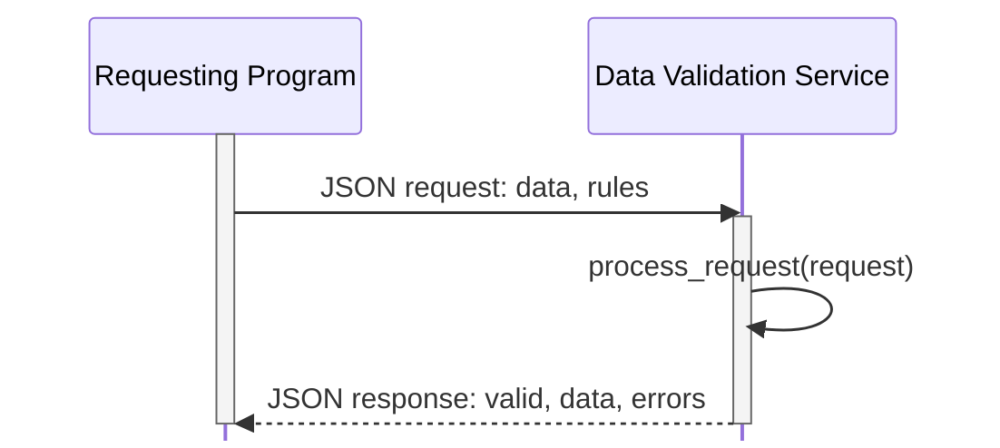

# Data Validation Service

Authors: Charles Gilbert and Mohana Vista

A Python microservice that checks incoming records for required fields, valid data types, and valid numerical ranges, then returns the data or appropraite error messages. 

## Requirements

- Python 3
- Dependencies listed in requirements.txt
    - pyzmq 27.3.0

## Setup

1. Clone this repository and open a terminal in its directory.

2. Create and activate a virtual environment:

    ```
    python3 -m venv .venv
    source .venv/bin/activate
    ```

3. Install dependencies: 

    ```
    python -m pip install -r requirements.txt
    ```

4. Run Data Validation Service

    Mac/Linux: `python3 data_validation.py`

    Windows: `python data_validation.py`

## Communication
Data Validation Services uses ZeroMQ RED/REP sockets over TCP. Requests and responses are JSON objects.

- Endpoint: `tcp://127.0.0.1:55001`

### How to Request Data
Connect to the service and send a JSON object containing 'data' and 'rules'.

| Property | Description |
|---|---|
| `data` | Object containing the record to validate. |
| `rules` | Object containing validation rules for each field. |


Rules accepts the following keys:
| Rule | Type | Description |
|---|---|---|
| `required` | Boolean | Whether a value must be present. Defaults to `false`. |
| `type` | String | Expected data type. |
| `min` | Number | Minimum allowed numeric value. |
| `max` | Number | Maximum allowed numeric value. |

Example request:

```python
import zmq

context = zmq.Context()
socket = context.socket(zmq.REQ)
socket.connect("tcp://127.0.0.1:55001")

request = {
    "data": {"name": "Alice", "age": 25},
    "rules": {
        "name": {"required": True},
        "age": {"required": True},
    },
}

socket.send_json(request)
```

### How to Receive Data
After sending a request, receive the response using `recv_json()` on the same socket. 

To receive a response for the example above:

```python
response = socket.recv_json()

if response["valid"]:
    print("Validation successful:", response["data"])
else:
    print("Validation failed:", response["errors"])

socket.close()
context.term()
```

Response fields:

| Property | Type | Description |
|---|---|---|
| `valid` | Boolean | Whether validation succeeded. |
| `data` | Object or null | Original data on success; `null` on failure. |
| `errors` | Array of strings | Error messages; empty on success. |

Example successful response:

```json
{
  "valid": true,
  "data": {"name": "Alice", "age": 25},
  "errors": []
}
```

Example response when a required `name` field is missing:

```json
{
  "valid": false,
  "data": null,
  "errors": ["name: missing field"]
}
```

Invalid JSON or an invalid request structure also returns `valid: false`,
`data: null`, and an explanatory message in `errors`.

## UML Sequence Diagram

